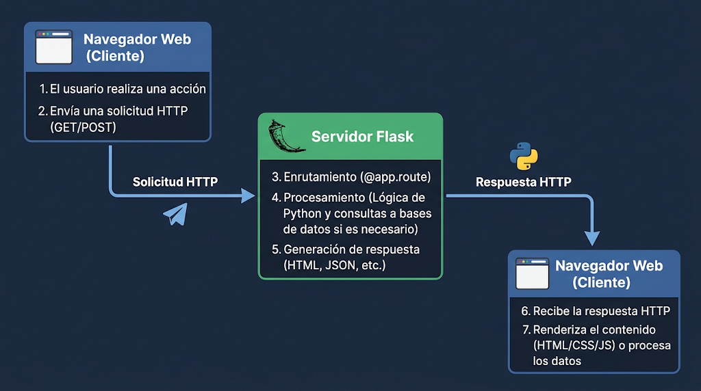

# Recorrido de una compra en la aplicación Flask

El proceso comienza cuando el empleado escribe la dirección de la aplicación en el navegador. El navegador es el **cliente**. Si la dirección contiene un nombre de dominio, este se traduce a una **dirección IP** para localizar el equipo donde se ejecuta la aplicación. La dirección también indica un **puerto**, que permite establecer la conexión con el servicio web correspondiente.

Para solicitar la página, el navegador envía una **request** mediante **HTTP** al **servidor**. La aplicación **Flask**, ejecutada en el servidor con **Python**, recibe la solicitud y busca una **ruta** que coincida con la dirección solicitada. Esa ruta atiende la petición inicial y prepara el formulario para que el empleado pueda capturar la cantidad y el precio.

Flask usa un **template** para generar la página y envía al navegador una **response** HTTP con el **HTML**. El navegador interpreta ese contenido y presenta el **Frontend**, es decir, la interfaz visible con la que interactúa el empleado. El **CSS** define aspectos de su apariencia; si la página incorpora **Bootstrap**, sus estilos y componentes ayudan a organizar el formulario y su presentación. En este recorrido no se requiere **JavaScript** para calcular el importe: el formulario se puede enviar directamente desde el navegador.

Después de escribir la cantidad y el precio, el empleado envía el formulario. El navegador manda esos valores al servidor en una nueva **request** **POST** dirigida a la ruta de cálculo. Flask recibe los datos y los entrega al **Backend**, la parte de la aplicación que procesa la solicitud. El código de **Python** obtiene la cantidad y el precio, los convierte a valores numéricos y calcula el importe multiplicándolos.

Con el importe calculado, Flask lo pasa a un **template** para generar el **HTML** del resultado. El servidor devuelve ese contenido en una **response** HTTP al cliente. Finalmente, el navegador interpreta el HTML y muestra el importe al empleado. Así, la captura y la visualización corresponden al **Frontend**, mientras que el procesamiento y el cálculo ocurren en el **Backend**.

## Diagrama del recorrido

El navegador representa al **cliente** y la aplicación Flask al **servidor**, al que se accede mediante una **dirección IP** y un **puerto**. Al enviar el formulario, el navegador remite la cantidad y el precio en una petición **HTTP POST**. Flask procesa esos datos con **Python**, calcula el importe y prepara el **HTML** de respuesta, que vuelve al cliente para que el navegador lo presente.